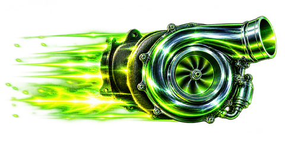
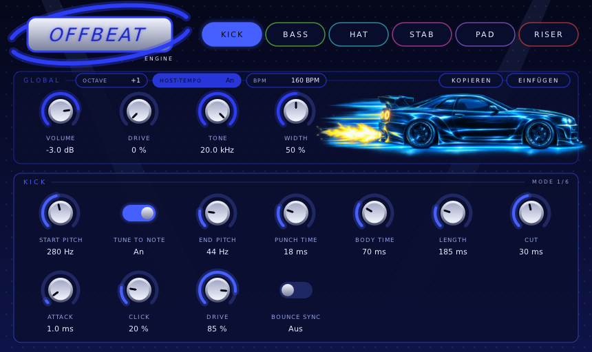
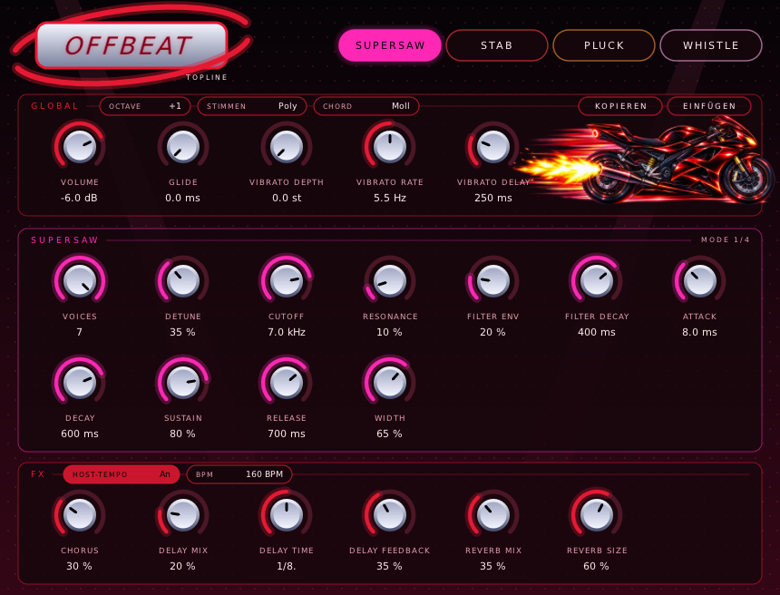
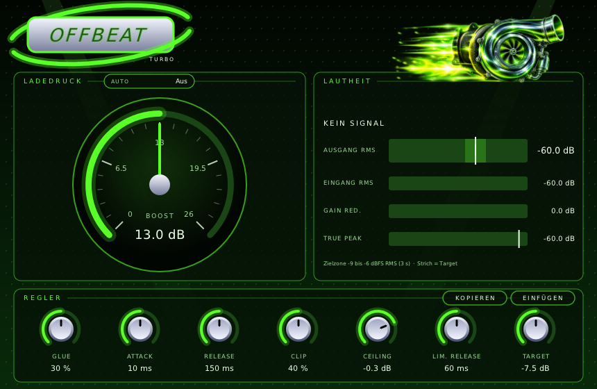
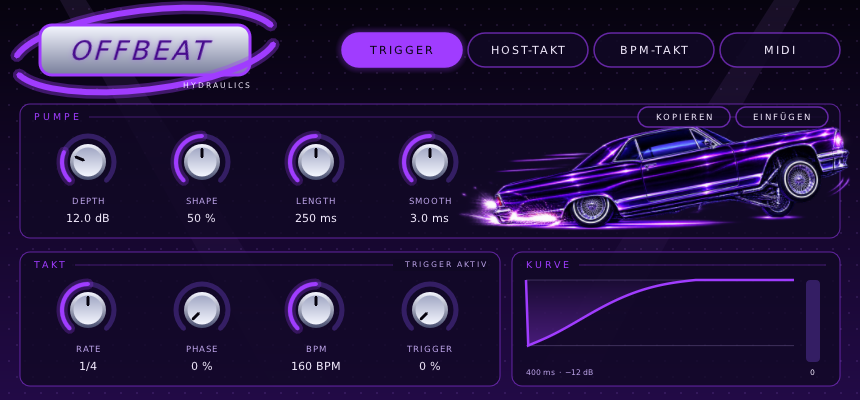

# Offbeat

**Vier freie Plugins für Hard Bounce und Bounce Techno:** Kick, Bass, Hats und Rave-Sounds, eine Melodie-Maschine, Master-Lautheit und Pumpen im Takt der Kick. Alle vier haben denselben Look und dieselbe Bedienung und laufen in FL Studio, Ableton, Logic, Bitwig, Reaper und LMMS, auf macOS, Windows und Linux.

<p>
  
  
  
  
</p>

| | Plugin | Typ | Was es kann |
|---|---|---|---|
|  | **[Offbeat Engine](https://github.com/lukestark-glitch/offbeat-engine)** | Instrument | Sechs Modi: **Kick** (Pitch-Fall, Sättigung, endet vor dem Offbeat), **Offbeat-Bass** (Bounce, Glide, Roll), **Hats** (weich, Closed/Open), **Rave-Stabs**, **Pads**, **Riser/Sirenen**. 13 Presets. |
|  | **[Offbeat Topline](https://github.com/lukestark-glitch/offbeat-topline)** | Instrument | Melodie: **Supersaw** (breite Leads und Akkorde), **Stab** mit Glanz, **Pluck**, **Rave-Pfeife**. Chord-Hold (Moll, Dur, 7er), Mono-Legato, Vibrato, Chorus, Delay, Hall. 10 Presets in F-Moll und A/E-Dur. |
|  | **[Offbeat Turbo](https://github.com/lukestark-glitch/offbeat-turbo)** | Effekt (Master) | **Lautheit:** Glue-Kompressor → Soft-Clipper → True-Peak-Limiter (Ceiling −0,3 dBTP). Ladedruck-Regler, Lautheitsanzeige mit Zielzone −9 … −6 dBFS RMS, Auto-Modus. Offline-Werkzeug zum Messen von Exporten. |
|  | **[Offbeat Hydraulics](https://github.com/lukestark-glitch/offbeat-hydraulics)** | Effekt | **Pumpen** im Takt der Kick: Tiefe, Form, Länge, Rate. Auslöser über Host-Takt, BPM, MIDI oder einen Trigger-Regler (in LMMS über den Peak Controller = echtes Sidechain). |

## Was alle vier gemeinsam haben

- **Formate:** VST3 · VST2 · AU · CLAP · LV2, Turbo und Hydraulics zusätzlich LADSPA für LMMS.
- **Systeme:** macOS als Universal-Binary (Intel + Apple Silicon), Windows und Linux.
- **Bedienung:**
  - ziehen (Shift = fein), Mausrad, Doppelklick = Standard,
  - **Klick auf den Wert = Zahl eintippen**,
  - **KOPIEREN / EINFÜGEN:** Jeder Sound lässt sich als JSON-Text kopieren, speichern, teilen und wieder einfügen. Jedes README enthält alle Presets als JSON zum Kopieren.
- **Offline-Renderer** mit `make check`: Jeder Klang wird ohne DAW gerendert und gegen feste Ziele gemessen (Tonhöhe, Länge, Breite, Lautheit, True-Peak, …).
- **Abhängigkeiten:** nur [DPF](https://github.com/DISTRHO/DPF).
- **Lizenz:** ISC, frei für alle, auch kommerziell.

## Loslegen

1. **Herunterladen:** In jedem Plugin-Repo unter **Releases** das ZIP für dein System (`…-macos.zip`, `…-windows.zip`, `…-linux.zip`).
2. **Installieren:** VST3, AU oder CLAP in den Plugin-Ordner kopieren und die DAW neu scannen lassen.
3. **Lesen:** die **[Setup-Anleitung](SETUP.md)** mit allen Ordnern, Gatekeeper auf dem Mac, FL Studio, Ableton, Logic, Bitwig, Reaper, LMMS und Carla.

> **Octave:** Engine und Topline stehen standardmäßig auf **Octave +1**, weil LMMS Noten eine Oktave zu tief schickt. **In allen anderen DAWs stellst du Octave auf 0.**

## Wie die vier zusammenspielen

```
Engine (Kick) ────────────────────────────────┐
Engine (Bass, Hats, Stab, Pad, Riser) ─┐      │
Topline (Akkorde, Melodie, Pfeife) ────┴─► Hydraulics (pumpt im Takt der Kick)
                                              │
                                              ▼
                                      Master ─► Turbo (Lautheit, True-Peak-sicher)
```

In `demo/offbeat-demo.mmp` liegt ein fertiges **LMMS-1.2-Projekt** (160 BPM, F-Moll, 32 Takte), das alle vier nutzt:
- **Engine** spielt Kick, Bass und Hats.
- **Topline** spielt Akkorde, Melodie und Pfeife.
- **Hydraulics** pumpt die Synths. Ausgelöst wird es von einem Peak Controller auf der Kick.
- **Turbo** sitzt im Auto-Modus auf dem Master.

Gerendert ergibt es −7,5 dBFS RMS und −0,32 dBTP. Zum Öffnen brauchst du die installierten Plugins und Carla.

## Alles auf einmal bauen

```sh
git clone --recurse-submodules https://github.com/lukestark-glitch/offbeat
cd offbeat
make          # alle vier Plugins bauen (Plugins landen jeweils in <plugin>/bin/)
make check    # alle Klang-Prüfungen
make install  # macOS: alle vier installieren
make update   # Submodules auf den neuesten Stand der Plugin-Repos holen
```

Voraussetzungen je System stehen in der [Setup-Anleitung](SETUP.md#5-selbst-bauen). Wie der Code aufgebaut ist und wie du ihn anpasst, erklärt jedes Repo in `docs/CODE.md`.

## Repos

| Repo | Inhalt |
|---|---|
| [offbeat](https://github.com/lukestark-glitch/offbeat) | diese Übersicht, Setup-Anleitung, Demo-Projekt, alle vier als Submodules |
| [offbeat-engine](https://github.com/lukestark-glitch/offbeat-engine) | Offbeat Engine, außerdem Quelle des gemeinsamen Codes (Oberflächen-Baukasten, JSON, Messwerkzeuge) |
| [offbeat-topline](https://github.com/lukestark-glitch/offbeat-topline) | Offbeat Topline |
| [offbeat-turbo](https://github.com/lukestark-glitch/offbeat-turbo) | Offbeat Turbo |
| [offbeat-hydraulics](https://github.com/lukestark-glitch/offbeat-hydraulics) | Offbeat Hydraulics |

## Lizenz

[ISC](LICENSE), wie in jedem Plugin-Repo: Du darfst alles frei nutzen, verändern und weitergeben, auch kommerziell.
